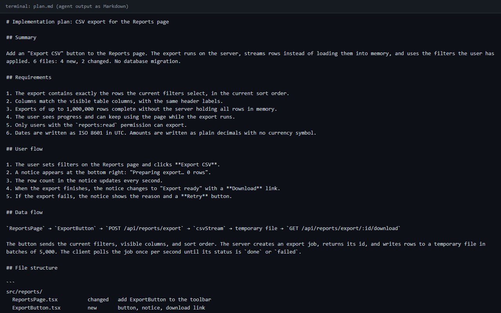
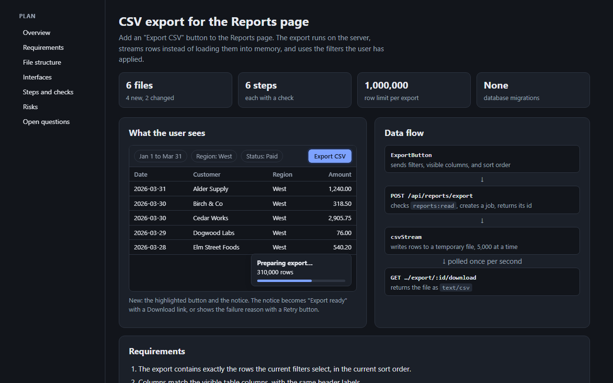
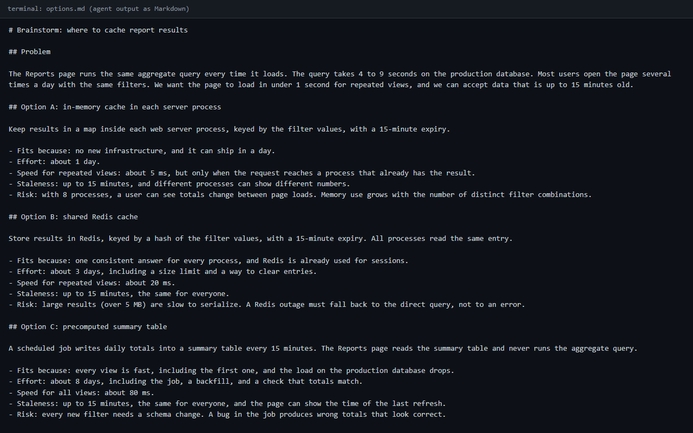
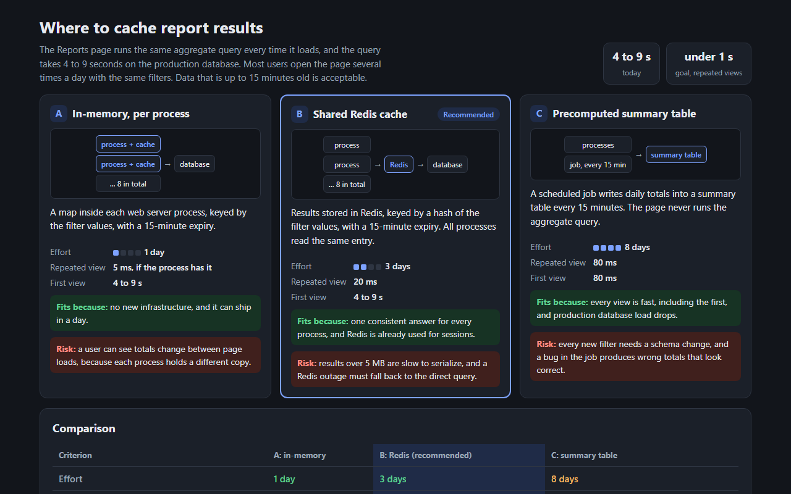

# cc-html-output-mod

A short standing instruction for Claude Code and Codex that makes them write documents meant for you (plans, specs, reports, handoffs, and similar) as self-contained HTML files instead of Markdown, plus a prompt that installs it for you.

## The problem it addresses

Coding agents now run for a long time and write long plans. A 50-line Markdown plan gets read. A 1,000-line Markdown plan tends to get skimmed and approved, and the agent then spends an hour building from a document that was not checked.

The idea comes from Thariq Shihipar of the Claude Code team, in an episode of the "How I AI" podcast. His point is that the agent can work from either format, so the format should be chosen for the person reviewing it: an HTML page can show a mockup of the screen, a diagram of the data flow, and a comparison of options side by side, and people read a page like that when they would skim the same content as text.

- [Episode page and summary](https://www.lennysnewsletter.com/p/how-i-ai-html-is-the-new-markdown)
- [Written walkthrough of the workflows](https://www.chatprd.ai/how-i-ai/claude-code-anthropic-thariq-shihipar-on-replacing-markdown-with-html)

This repository turns that practice into an instruction you install once, so you do not have to ask for HTML in every session.

## What changes after you install it

**The agent writes these as HTML files:** plans, specs, design docs, brainstorms and option comparisons, reports, research findings, reviews, status files, handoffs, roadmaps, and standalone documentation.

**Long chat replies of those kinds become files too.** If the reply would run past about one screen, the agent writes an HTML file and gives you a short summary and the file path in chat.

**Each document is one file.** Its CSS and JavaScript are embedded, and the markup is plain enough that a later agent session can read and edit it. The file is saved where the Markdown file would have gone, with an `.html` extension, and opened in your default browser when the agent is able to.

**You choose whether documents may load libraries from the internet.** The rule as written keeps every file working offline. The install prompt asks whether you would instead allow well-known libraries from a CDN, such as Mermaid for diagrams or Reveal.js for slides. See [Offline files or CDN libraries](#offline-files-or-cdn-libraries).

**The agent decides the layout.** The rule tells it to use mockups, diagrams, code excerpts, tabs, or whatever else helps you understand and check the content. It does not prescribe sections or styling.

**Nothing is published.** Files stay on your machine unless you ask otherwise.

**For sections that are awkward to edit by hand,** the agent offers a small throwaway editor page with a copy button, so you can change values in a form and paste the result back into the session.

### What stays Markdown

- Files a tool loads by name or format: `CLAUDE.md`, `AGENTS.md`, `SKILL.md`, memory files
- `README.md` and `CHANGELOG.md`, which code hosts render as formatted pages
- Files a skill tells the agent to write as `.md` for another agent to execute
- Any repository that already keeps its docs in Markdown

Short answers in chat are not affected.

## Examples

These examples were generated for this repository. Each pair is the same document twice: a Markdown version, and an HTML version written by an agent following the rule. The HTML versions shorten some sentences and move some details into mockups and diagrams. The screenshots are the first screen of each at 1280 by 800. The Markdown screenshots show the file as plain text, which is how it appears in a terminal or a text editor.

### An implementation plan

| Markdown, first screen | HTML, first screen |
|---|---|
|  |  |

Source files: [`examples/plan.md`](examples/plan.md) and [`examples/plan.html`](examples/plan.html)

What the HTML version adds on the first screen: a mockup of what the user will see, with the new button and progress notice marked; the data flow as a sequence of boxes; and four summary tiles. Further down, each file is tagged as new or changed, each step sits beside its check, and risks are sorted by likelihood.

### A brainstorm comparing three options

| Markdown, first screen | HTML, first screen |
|---|---|
|  |  |

Source files: [`examples/options.md`](examples/options.md) and [`examples/options.html`](examples/options.html)

What the HTML version adds on the first screen: all three options side by side, a small architecture diagram for each, the effort shown as a meter, and the recommended option outlined. In the Markdown version you read the options one after another and have to hold the earlier ones in memory.

To see the pages themselves, clone the repository and open the two `.html` files in a browser. They follow your system's light or dark setting.

## Install

### With the prompt

1. Open [`PROMPT.md`](PROMPT.md) and copy the whole file.
2. Paste it into a Claude Code or Codex session.

The agent reads your existing user-level instruction files, tells you what it found, and asks four things: which tools to install for, which install method to use, whether you want to change the wording (including whether documents may load libraries from the internet), and whether you want the optional skill. It backs up every file before changing it, verifies the result in a fresh session, and tells you how to undo it.

### Install methods

The prompt describes these and asks you to choose. None is the default.

One fact limits the choices: Claude Code expands `@path` imports inside `CLAUDE.md`, and Codex does not expand imports inside `AGENTS.md`.

| Method | What it does | Good when | Cost |
|---|---|---|---|
| 1. Paste into each global file | Adds the rule to `~/.claude/CLAUDE.md`, `~/.codex/AGENTS.md`, or both | You use one tool, or want nothing to depend on imports | With two tools, the rule exists twice and later edits are made twice |
| 2. One shared file | `~/.codex/AGENTS.md` holds your shared user-level instructions; `~/.claude/CLAUDE.md` starts with one line, `@~/.codex/AGENTS.md`, followed by anything meant for Claude Code alone | You use both tools and want to edit one file | Existing `CLAUDE.md` content has to be merged first; if the import stops working, Claude Code loses the shared instructions without an error |
| 3. A standalone rule file | The rule lives in its own file: in `~/.claude/rules/`, which Claude Code loads without an import, or elsewhere with an `@` import line in `CLAUDE.md` | You want your existing `CLAUDE.md` content left as it is | Codex still needs the text pasted into `AGENTS.md` |
| 4. One project only | Adds the rule to one repository's instruction file. Codex reads `AGENTS.md`; Claude Code reads `CLAUDE.md`, and recent versions read `AGENTS.md` when there is no `CLAUDE.md` | You want to try it in one place, or apply it for a team | Applies only in that repository, and to everyone who uses it if the file is committed |

Methods 2 and 3 can rely on an `@` import. Some Claude environments, such as Cowork sessions in the desktop app, skip user-level imports that point outside the working folder, so the rule does not load there.

### By hand

These steps are method 1 from the table above.

1. Copy the text of [`html-output-rule.md`](html-output-rule.md).
2. Paste it at the end of the file for your tool: `~/.claude/CLAUDE.md` for Claude Code, `~/.codex/AGENTS.md` for Codex. Create the file if it does not exist. If `~/.codex/AGENTS.override.md` exists and is not empty, Codex reads it in place of `AGENTS.md`, so add the rule there.
3. Start a new session and ask for a plan for a small feature.

## Offline files or CDN libraries

The install prompt asks you to pick one. If you install by hand, the rule text in `html-output-rule.md` is the offline version.

| | Offline only | CDN libraries allowed |
|---|---|---|
| Diagrams and mockups | Drawn with HTML, CSS, and inline SVG | Can use a diagram library such as Mermaid |
| Slides | Built with plain HTML and CSS | Can use a slide library such as Reveal.js |
| Opening a file without a network connection | Works | Text displays; diagrams, icons, and fonts from the CDN do not |
| Opening a file years later | Works | Depends on the CDN still serving that version |
| Privacy when opened | Nothing is requested from a third party | The browser contacts the CDN |
| Agent effort for complex diagrams | Higher | Lower |

To allow CDN libraries by hand, replace the first sentence of the rule's third paragraph with:

> Each HTML document is one file with its own CSS and JavaScript embedded and plain semantic markup so a later agent can read and edit it. Well-known libraries may be loaded from a CDN when they help, such as Mermaid for diagrams, Reveal.js for slides, an icon set, or web fonts; pin exact versions.

The example files in this repository are the offline kind.

## Changing the rule

The rule is three paragraphs of plain text. Edit it to suit you: remove document types you still want as Markdown, add exceptions, change the "about one screen" threshold, or drop the line about opening the browser.

Keep it short. The source episode makes the point that long, prescriptive instructions tend to produce worse results than naming what you care about and leaving the rest to the agent, and the rule is written that way on purpose.

## When the output is poor

Three common problems, each with a follow-up request that fixes it:

| Problem | What it looks like | What to ask for |
|---|---|---|
| Text wrapped in tags | The page is the same headings and bullet lists as the Markdown version, with a stylesheet | Ask for a comparison layout or cards, a mockup for each screen or option, and the risks and recommendation set apart from the body text |
| Polished but vague | The page looks finished, and the technical content is general | Ask for exact file paths, the data flow, code excerpts for the main functions, and the command or check that verifies each step |
| Unstyled or broken when opened | The file depends on a remote stylesheet, font, or script that did not load | If you chose offline files, ask for all CSS and JavaScript to be embedded and all remote links removed. If you allow CDN libraries, ask the agent to check each library URL and pin its version |

## Optional skill

The rule decides when an agent writes HTML and is loaded into every session. The skill in [`skills/html-documents/`](skills/html-documents/SKILL.md) is a longer set of instructions that an agent loads only when the task calls for it. It starts with guidance that applies to every HTML document: checking the content against the real code or current documentation, requirements for the file itself, which page form suits which content, and which diagram type suits what is being shown. It then covers three jobs:

- **Review documents:** what a brainstorm or plan should contain, and three failures to check for before handing it over
- **Throwaway editors:** a single-file page for editing one structured section of a document, with a button that exports the result in the original format
- **A design system page:** one `design_system.html` per project, extracted from the existing code, for people and agents to refer to

The rule works without the skill. Install the skill if you want more consistent results on those three jobs.

To install it, copy the `html-documents` folder into the skills folder of each tool you use:

- Claude Code: `~/.claude/skills/html-documents/SKILL.md`
- Codex: `html-documents/SKILL.md` inside Codex's user-level skills folder. Current Codex documentation names `~/.agents/skills/`; older versions used `~/.codex/skills/`

The skill is written for this repository. The practices it describes come from the episode, and the "How I AI" site has its own write-up of each one: [HTML project plans](https://www.chatprd.ai/how-i-ai/workflows/create-interactive-html-project-plans-with-ai-for-better-visualization), [disposable editors](https://www.chatprd.ai/how-i-ai/workflows/build-disposable-micro-apps-with-ai-to-edit-complex-plans), and [a living design system](https://www.chatprd.ai/how-i-ai/workflows/generate-a-living-html-design-system-with-ai-for-ui-consistency).

## Costs and limits

- **More tokens and time per document.** An HTML page is larger than the same content in Markdown, both to write and for a later session to read back.
- **Harder to edit by hand.** In practice you ask the agent to make changes, or use a throwaway editor page for structured sections.
- **A well-designed page can make weak reasoning look finished.** The format helps you read the plan. Checking whether the plan is right is still your job.
- **It is an instruction, not an enforcement mechanism.** Agents follow it most of the time. If one writes Markdown anyway, ask it to redo the document as HTML.
- **Code hosts show `.html` files as source.** That is why READMEs and existing Markdown docs are excluded.

## Uninstall

If you used the prompt, it made a `.bak-YYYYMMDD` backup of every file it changed. Restoring a backup undoes the install for that file, and also removes any edits you made to the file afterwards. To uninstall without the backups:

- **Method 1:** delete the "Document format" section from each file it was added to.
- **Method 2:** copy the content of `~/.codex/AGENTS.md`, without the "Document format" section, back into `~/.claude/CLAUDE.md` in place of the import line. Then delete the section from `AGENTS.md`. Do not only remove the import line: that leaves Claude Code with none of your shared instructions.
- **Method 3:** delete the standalone rule file, remove its `@` import line from `CLAUDE.md` if you added one, and delete the section from `AGENTS.md` if you use Codex.
- **Method 4:** delete the section from the repository's instruction file.

If you installed the skill, delete the `html-documents` folder from each skills folder.

## Files

| File | Purpose |
|---|---|
| [`PROMPT.md`](PROMPT.md) | Paste into Claude Code or Codex to install the rule with your choice of method |
| [`html-output-rule.md`](html-output-rule.md) | The rule text alone, for installing by hand |
| [`skills/html-documents/SKILL.md`](skills/html-documents/SKILL.md) | Optional skill with detailed instructions for review documents, throwaway editors, and a design system page |
| [`examples/`](examples) | Two documents as Markdown and as HTML, with screenshots |

## License

MIT. See [`LICENSE`](LICENSE).
